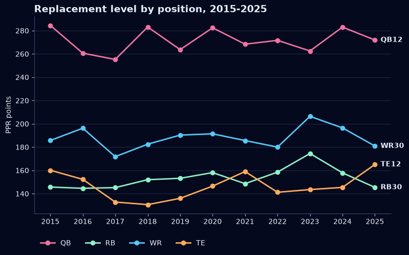
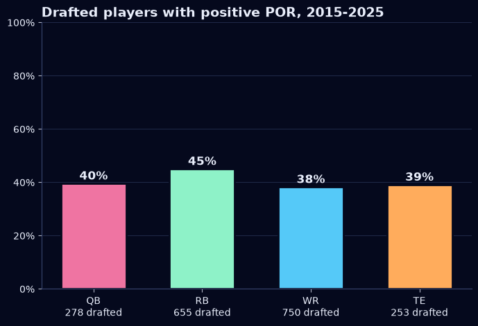
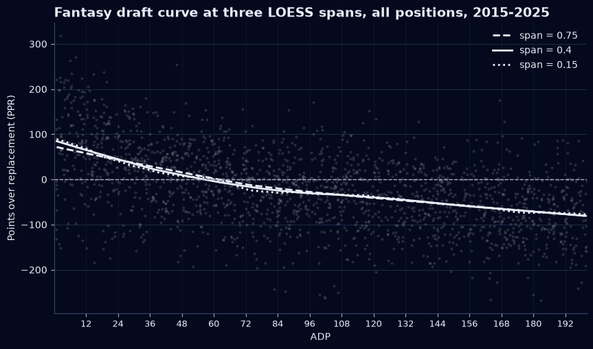
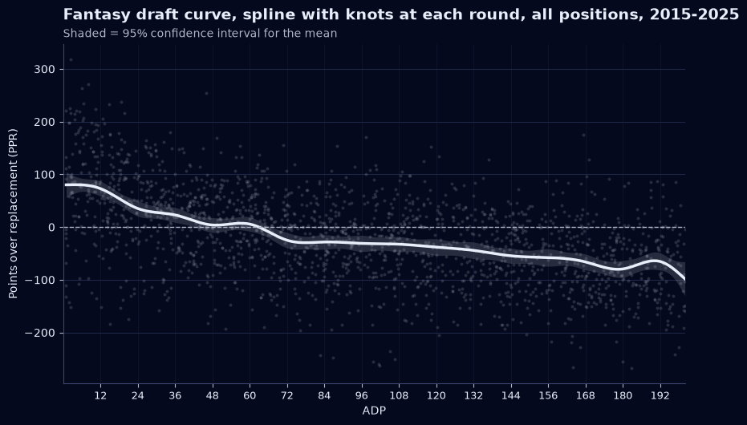
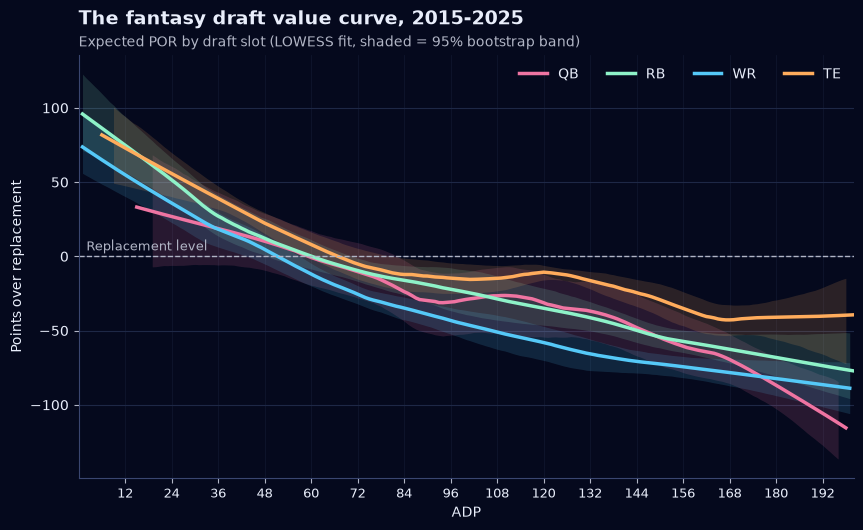
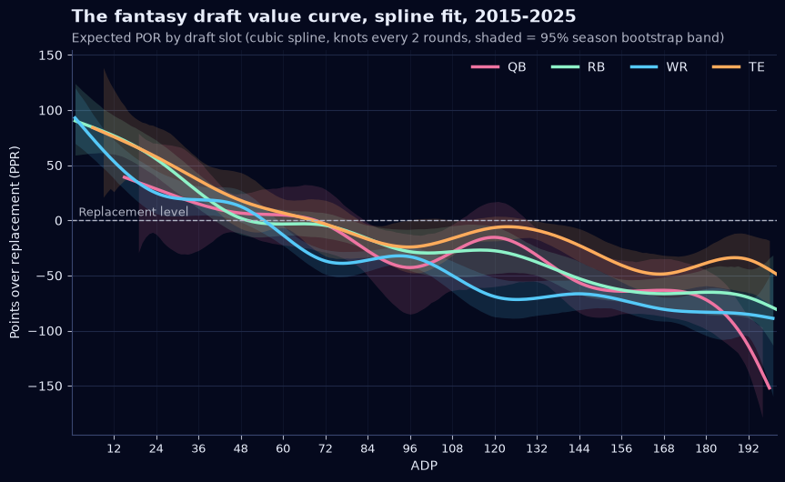
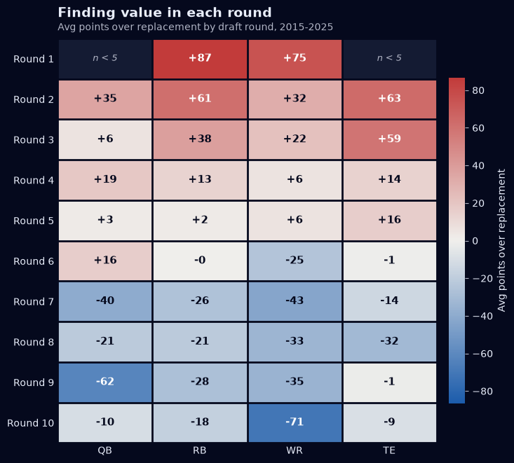
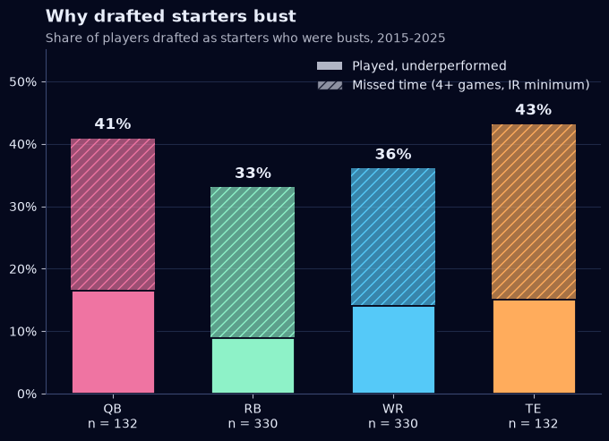
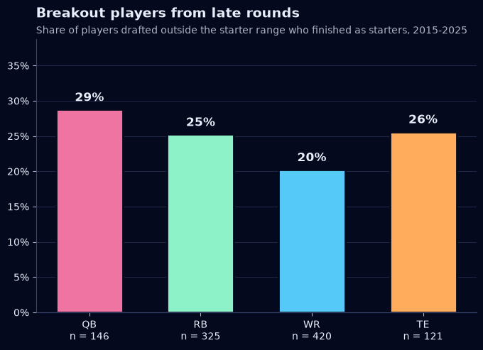

# How Well Does the Fantasy Football Market Value Players?

**Daniel Vazquez | ITCS 5010 Advanced Football Analytics | UNC Charlotte | Fall 2026**

Fantasy football drafts are essentially a market. Average draft position (ADP) is the price that millions of drafters set for each player. This project was guided by the following questions:

1. **How accurate is ADP, and at which positions does the market miss most?**
2. **What does a fantasy draft value curve look like, and how does value fall off by position?**

## References
### Fantasy football analytics

- **Becker & Sun (2016), "An analytical approach for fantasy football draft and lineup management"** (*Journal of Quantitative Analysis in Sports*)
  - Predicts player performance from historical data, then uses mixed-integer optimization to choose draft picks and weekly lineups

- **Abadzic, Cheun & Patel (2024), "Data Analysis on Predicting the Top 12 Fantasy Football Players by Position"** (*SMU Data Science Review*)
  - Uses machine learning to forecast the top 12 scorers at each position, including breakout candidates and risk

- **Dynasty Nerds (2020), "How NFL Draft Selection Predicts Fantasy Rookie Success"**
  - Links NFL draft pick to rookies' fantasy output in their first four seasons
  - Draft pick matters differently by position: the exact pick matters most for QBs, the round matters most for RBs, WRs from rounds 1-2 are the safest, and TEs drop off most after round 1

### Draft curves

- **Schuckers (2011), "An Alternative to the NFL Draft Pick Value Chart Based upon Player Performance"** (*Journal of Quantitative Analysis in Sports*)
  - Fits LOESS curves of player performance (games played, games started, career AV, Pro Bowls) against pick number for the 1991-2001 drafts
  - Finds the NFL trade value chart overvalues early picks (especially the first 50) and undervalues picks from about 100 onward
  - Proposes a performance-based chart that shrinks the first-to-last pick value gap from about 7,500 to 1 to about 10 to 1

- **Lopez (2016), "The making and comparison of draft curves"**
  - Uses LOESS (span 0.4) to build draft curves for the NFL, NBA, NHL and MLB, each with its own value measure
  - The NBA curve is steepest (top pick worth about 20 times a late second-rounder) and the NFL curve is flattest (about 2 times)

- **Lopez (2018), "Rethinking draft curves"**
  - Argues teams want superstars, not average production, and estimates each pick's chance of producing one
  - Blends that "superstar curve" with the average-value curve

- **Massey & Thaler (2013), "The Loser's Curse"** (*Management Science*)
  - Shows NFL teams overvalue top draft picks relative to their surplus value


### How this project builds on that work

- Applies the **draft curve method** to fantasy drafts: ADP is the pick, and points over replacement is the value
- Splits value **by position**, similar to how Dynasty Nerds did for NFL rookies
- Adds **season-level bootstrap bands** to show how much the curves would change with different seasons
- Tests **ADP accuracy** directly

---

## Data Sources

| Source | What it provides | Access |
|---|---|---|
| [FantasyPros](https://www.fantasypros.com/nfl/adp/ppr-overall.php) PPR ADP | Consensus ADP across major platforms (ESPN, Sleeper, CBS, RTSports, Fantrax, and others), one file per season | Downloaded manually as CSVs into `data/raw/adp/` |
| [nflreadpy](https://github.com/nflverse/nflreadpy) (nflverse) | Weekly player stats, including PPR fantasy points | `nfl.load_player_stats()` |

**Final dataset:** 1,936 drafted player-seasons. Every QB, RB, WR and TE drafted within the first 200 picks, 2015-2025 (167 to 192 players per season).

---

## Data Setup Choices

| Choice | Decision | Reasoning |
|---|---|---|
| Scoring | Full PPR, regular season only | Most common format |
| League | 12 teams; 1 QB, 2 RB, 2 WR, 1 TE, 1 FLEX | Standard league setup |
| Draft window | ADP 1 to 200 (overall pick) | Same draft range every season. A player count reached ADP 260 in a season |
| Seasons | 2015-2025 | Earlier FantasyPros files are too short to reach ADP 200 |
| Value measure | Total season points over replacement (POR) | Raw points can't be compared across positions |
| Replacement level | QB12, RB30, WR30, TE12 | The last starter at each position |
| Missed seasons | Kept as zero-point busts (23 players) | The drafter still used the pick. Dropping them would make ADP look better than it was (survivorship bias) |
| Missed time | 4+ games missed | The minimum to qualify for NFL injured reserve (IR) |


## Data Challenges

- Relatively small data sample: 
    - 11 seasons
    - 1,936 drafted player-seasons;
        - 278 QBs
        - 655 RBs
        - 750 WRs
        - 253 TEs

Injuries are unpredictable.

Joining two sources by player name was time consuming:
- **Name differences:** "Hollywood Brown" vs. "Marquise Brown"  Fixed with a name-cleaning function and a short lookup table.
- **Position differences:** nflreadpy lists Travis Hunter as a CB and N'Keal Harry as a TE. A second matching pass handles a named list of exceptions only.
- **A false match caught in testing:** Michael Thomas (WR) missed all of 2021, and a name-only match only showed a defensive back with the same name. Restricting the second pass to named exceptions fixed it.
- **Historical team labels:** FantasyPros attaches each player's *current* team and bye week to old seasons.

Final match: every drafted player matched to his stats except 23 players who missed an entire season (injuries, suspensions and holdouts).

## Replacement level (average, 2015-2025)

| QB | WR | RB | TE |
|---|---|---|---|
| 271.6 | 187.9 | 153.1 | 146.6 |






---
---  


## Question 1: How Accurate Is ADP?

Accuracy is measured by position, with each season as one data point:

| Position | Seasons | Spearman (mean) | Spearman (SD) | Hit rate | MAE (relative) | CI low | CI high |
|---|---|---|---|---|---|---|---|
| QB | 11 | 0.385 | 0.187 | 0.591 | 0.773 | 0.260 | 0.511 |
| RB | 11 | 0.537 | 0.140 | 0.670 | 0.570 | 0.443 | 0.631 |
| WR | 11 | 0.545 | 0.098 | 0.639 | 0.721 | 0.479 | 0.611 |
| TE | 11 | 0.400 | 0.136 | 0.568 | 0.848 | 0.309 | 0.491 |

- **The ADP for RBs and WRs better than QBs and TEs.**  When averaging the RB/WR Spearman values together, and the QB/TE values, and subtracting, the gap averages 0.15. RB/WR is more accurate across 9 out of 11 of the seasons. (paired t-test p = 0.017; Wilcoxon p = 0.014).
- **QB is the most volatile.** In 2025, QB ADP was barely better than random (Spearman 0.04): Jayden Daniels went from QB3 to QB34, while Matthew Stafford went from QB23 to QB3.
- **Note:** fewer QBs and TEs are drafted, and QB scores bunch together, which naturally lowers rank correlations. 
---

## Question 2: The Fantasy Draft Value Curve

Inspired by NFL draft pick value curves (Massey & Thaler; Lopez; Schuckers), with points over replacement as the value measure.

### All positions

- LOESS at three spans (0.75, 0.4, 0.15) gives nearly identical curves, so the shape is not dependent on the smoothing choice.



- A spline with knots at the end of each round shows **value roughly halving from round 1 to round 2** (about 73 POR at pick 12 to 35 at pick 24).
- **Draft pick explains about 27% of a player's season value** (spline R² = 0.27).





| Pick | Expected POR |
|------|--------------|
| 1    | 80.1         |
| 12   | 72.9         |
| 24   | 35.2         |
| 36   | 23.0         |
| 48   | 3.8          |
| 60   | 5.6          |
| 72   | -24.9        |
| 84   | -28.4        |
| 96   | -31.0        |
| 108  | -32.5        |

### By position

Using the LOESS span at 0.4:
- **RBs** deliver the most value at the top of the draft.
- **WRs** fall below replacement first, around pick 48/round 4.
- **QB** value starts lower and declines slowly, which supports waiting on a QB.
- Uncertainty bands come from resampling whole seasons (2,000 bootstrap resamples). RB, WR and TE bands overlap in the first 24 picks, so position differences are just suggestive 



**Spline value curves for all four positions:**


- RB and WR both start around +92 but WR then falls faster than RB through pick 24
### Average POR by round


- **Round 3 TEs** averaged +59 POR, vs. +38 for RBs and +22 for WRs at the same picks (smaller sample).
- **WR value drops off in round 6** (-25) while other positions sit near zero.

## Busts and Breakouts

- **Bust:** drafted as a starter, didn't finish as one.
- **Breakout:** drafted outside the starter range, finished inside it.

| | QB | RB | WR | TE |
|---|---|---|---|---|
| Bust rate | 41% | 33% | 36% | 43% |
| Share of all drafted starters who busted from missed time | 24% | 24% | 22% | 28% |
| Breakout rate | 29% | 25% | 20% | 26% |

### Busts


-   **Most busts come from missed time**

### Costliest Busts  

| Season | Player | Games | Position | ADP rank | Finish rank | Drop | POR |
|---|---|---|---|---|---|---|---|
| 2024 | Christian McCaffrey | 4 | RB | 1 | 68 | -67 | -110.1 |
| 2017 | David Johnson | 1 | RB | 1 | 106 | -105 | -132.2 |
| 2023 | Justin Jefferson | 10 | WR | 1 | 33 | -32 | -4.2 |
| 2022 | Jonathan Taylor | 11 | RB | 1 | 33 | -32 | -12.1 |
| 2021 | Christian McCaffrey | 7 | RB | 1 | 38 | -37 | -21.1 |
| 2020 | Christian McCaffrey | 3 | RB | 1 | 54 | -53 | -67.7 |
| 2015 | Le'Veon Bell | 6 | RB | 1 | 47 | -46 | -34.5 |
| 2020 | Saquon Barkley | 2 | RB | 2 | 116 | -114 | -142.7 |
| 2018 | Le'Veon Bell | 0 | RB | 2 | 150 | -148 | -152.0 |
| 2015 | Eddie Lacy | 15 | RB | 4 | 32 | -28 | -5.1

- **9 of the 10 earliest busted picks missed time** 


### Breakouts



### Biggest Breakouts

| Season | Player | Games | Position | ADP rank | Finish rank | Jump | POR |
|---|---|---|---|---|---|---|---|
| 2023 | Kyren Williams | 12 | RB | 71 | 7 | +64 | 80.5 |
| 2016 | Jordan Howard | 15 | RB | 62 | 10 | +52 | 85.5 |
| 2017 | Alvin Kamara | 16 | RB | 52 | 3 | +49 | 175.2 |
| 2015 | DeAngelo Williams | 16 | RB | 53 | 4 | +49 | 87.7 |
| 2025 | Wan'Dale Robinson | 16 | WR | 63 | 14 | +49 | 37.0 |
| 2018 | James Conner | 13 | RB | 55 | 6 | +49 | 128.0 |
| 2017 | Dion Lewis | 16 | RB | 61 | 13 | +48 | 57.8 |
| 2021 | Amon-Ra St. Brown | 16 | WR | 70 | 22 | +48 | 41.7 |
| 2023 | Nico Collins | 15 | WR | 60 | 12 | +48 | 54.0 |
| 2015 | Doug Baldwin | 16 | WR | 56 | 10 | +46 | 83.2 |

**The biggest breakouts were late-round RBs:** Kyren Williams 2023 (RB71 → RB7), Alvin Kamara 2017 (RB52 → RB3), James Conner 2018 (RB55 → RB6).

---

## Takeaways

1. **The market is fairly efficient at RB and WR, and much less so at QB and TE.**
2. **Value is concentrated early:** it roughly halves from round 1 to round 2, and draft slot explains only about a quarter of season value.
3. **The biggest risk is availability.** Most early busts were injuries or other missed time, not players who were healthy and bad.
4. **Fantasy is incredibly difficult to predict.**

## Limitations

- FantasyPros ADP mixes real leagues with some mock drafts.
- Total points penalize injured players. A per-game version would separate health from talent.
- Single-season value only; dynasty and keeper value are not measured.


## Future Work

- **ADP vs. expert rankings (ECR):** 
- **Per-game analysis:** total points = availability × per-game production. Does ADP predict per-game scoring better than totals?
- **A "perfect foresight" curve:** the value of the k-th best player-season, to measure how much value is lost to uncertainty at each pick.

---

## References

- Schuckers (2011), An Alternative to the NFL Draft Pick Value Chart
- Lopez (2016), The making and comparison of draft curves
- Lopez (2018), Rethinking draft curves
- Dynasty Nerds (2020), How NFL Draft Selection Predicts Fantasy Rookie Success
- Abadzic, Cheun & Patel (2024), SMU Data Science Review
- Shipman (2009), FDG ‘09
- Becker & Sun (2016), JQAS 12(1): 17-30 

---

## Repository Structure

```
Fantasy-Football-Analysis/
├── README.md
├── requirements.txt
├── fantasy_market_efficiency.ipynb     # Full analysis
├── data/
│   ├── raw/adp/                        # FantasyPros PPR ADP, one CSV per season
│   └── processed/                      # Cleaned, matched dataset
├── figures/                            # All charts used in the presentation
└── homework/                           # Homework problem and data
```


